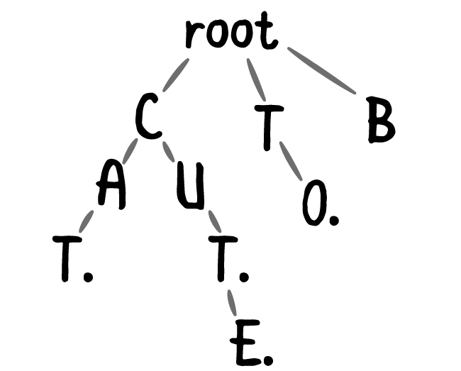

# Префиксное дерево (Trie)

## Что такое префиксное дерево

Префиксное дерево (Trie, произносится "трай") - это дерево для хранения набора строк.
В нём каждое ребро подписано одним символом.
Путь от корня до узла задаёт начало строки, то есть её префикс.
Если узел отмечен как конец слова, значит путь до этого узла является словом из набора.
Главная идея: строки с общим началом идут по одному и тому же пути и не дублируются.

Это не бинарное дерево поиска.
В Trie нет сравнения ключей между собой, а ветвление идёт по следующему символу строки.

## Простой пример

Добавим в дерево слова `app`, `apple`, `apply`, `ape`, `bat` и `batch`.

```text
root
|- a
|  |- p
|  |  |- p (конец слова "app")
|  |  |  `- l
|  |  |     |- e (конец слова "apple")
|  |  |     `- y (конец слова "apply")
|  |  `- e (конец слова "ape")
`- b
   `- a
      `- t (конец слова "bat")
         `- c
            `- h (конец слова "batch")
```

Слова `app`, `apple` и `apply` начинаются одинаково, поэтому у них общий путь `a -> p -> p`.
После узла `p` у слова `app` стоит отметка конца слова.
У слов `apple` и `apply` путь продолжается символами `l -> e` и `l -> y`.

Если искать слово `app`, нужно дойти до узла `p` и проверить, что он отмечен как конец слова.
Если искать префикс `appl`, достаточно проверить, что путь `a -> p -> p -> l` существует.
Отметка конца слова для префикса не требуется.

## Основные операции

| Операция             | Что делает                                      | Время | Память |
|----------------------|-------------------------------------------------|-------|--------|
| `Insert(word)`       | создаёт путь по символам и ставит флаг `isEnd`  | O(L)  | O(L)   |
| `Search(word)`       | проверяет путь и флаг `isEnd`                   | O(L)  | O(1)   |
| `StartsWith(prefix)` | проверяет только существование пути по префиксу | O(L)  | O(1)   |

Здесь `L` - длина слова или префикса.
Время не зависит от количества строк в дереве, потому что мы проходим только по символам запроса.
Память на всё дерево в худшем случае равна O(суммарной длины всех строк).
В лучшем случае общие префиксы хранятся один раз, и памяти нужно меньше.

В `main.go` узел дерева - это структура `TrieNode`.
Поле `children` хранит переходы по символам, а поле `isEnd` отмечает конец слова.
Корень дерева не хранит символ и соответствует пустому префиксу.

## Где можно использовать

- Автодополнение в поиске и редакторах: по введённому префиксу можно найти все слова, которые с него начинаются.
- Проверка орфографии и словари: быстро проверить, есть ли слово в словаре.
- Подсказки в поисковых системах: показать запросы, начинающиеся с текста пользователя.
- Контакты в телефоне и режим T9: искать имена и слова по первым нажатым символам.
- Маршрутизация IP-адресов: выбирать маршрут по самому длинному совпавшему префиксу сети.
- Игры со словами: проверять слова и искать возможные ходы в Scrabble, кроссвордах и Boggle.
- Фильтрация запрещённых слов и антиспам: искать нежелательные последовательности символов.
- Хранение словарей и сжатие: общие префиксы строк не повторяются в памяти.
- Компиляторы и парсеры: хранить ключевые слова и распознавать их по префиксу.
- Биоинформатика: искать последовательности нуклеотидов или аминокислот по общим префиксам.

## Плюсы префиксного дерева

- Поиск и вставка работают за O(L), где `L` - длина строки.
- Общие префиксы хранятся один раз, поэтому дерево хорошо подходит для словарей.
- Поиск всех слов по префиксу получается естественным обходом поддерева.
- Время операции не зависит от общего числа строк в дереве.

## Минусы префиксного дерева

- Каждый символ слова может занимать отдельный узел, поэтому памяти нужно много.
- Для больших алфавитов у узла появляется много переходов, и это увеличивает расход памяти.
- Для коротких строк без общих префиксов хеш-таблица или массив могут оказаться проще и экономнее.
- Реализация сложнее, чем у обычной хеш-таблицы.

## Варианты и оптимизации

- Сжатое префиксное дерево (radix tree, Patricia trie) объединяет цепочки узлов с одним ребёнком.
- Для маленького алфавита вместо `map` можно использовать массив переходов, например `[26]*TrieNode` для латинских букв.
- Суффиксное дерево и суффиксный автомат решают похожие задачи для всех подстрок строки.

## Учебные задачи

Задачи идут от простых к более сложным.
В каждой директории есть README с объяснением, `main.go` с комментариями и `main_test.go` с тестами.

- [01. Вставка и поиск слова](01_insert_and_search/README.md) - базовые операции `Insert` и `Search`.
- [02. Поиск по префиксу](02_prefix_search/README.md) - проверка, есть ли слово с указанным началом.
- [03. Сколько слов начинается с префикса](03_count_prefix/README.md) - счётчик слов в каждом узле.
- [04. Автодополнение по префиксу](04_autocomplete/README.md) - сбор всех слов с префиксом в алфавитном порядке.
- [05. Наибольший общий префикс](05_longest_common_prefix/README.md) - общий путь всех слов в дереве.
- [06. Поиск с шаблоном](06_wildcard_search/README.md) - точка `.` заменяет любую одну букву.

Запуск тестов для всех задач:

```bash
go test ./ds/trees/trie_prefix/...
```

## Дополнительная визуализация


